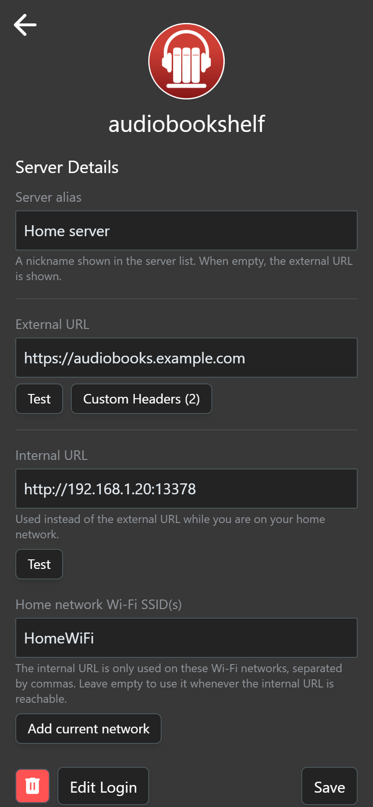
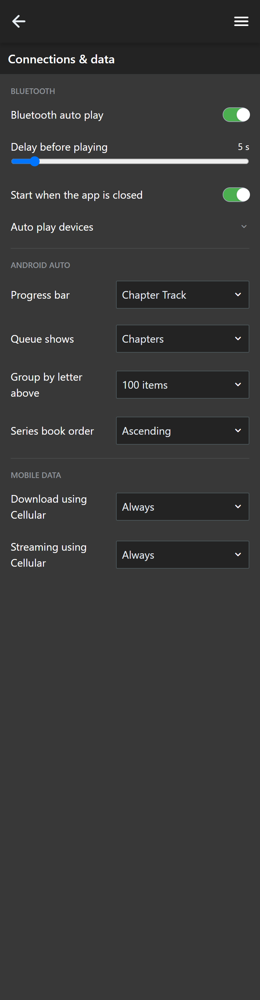
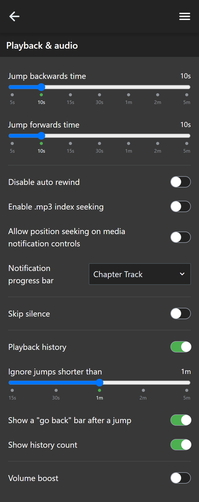
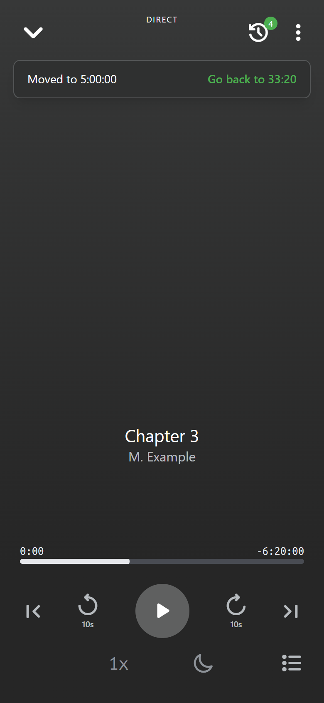
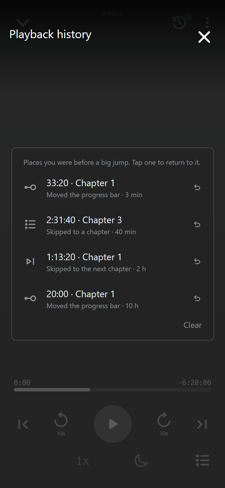
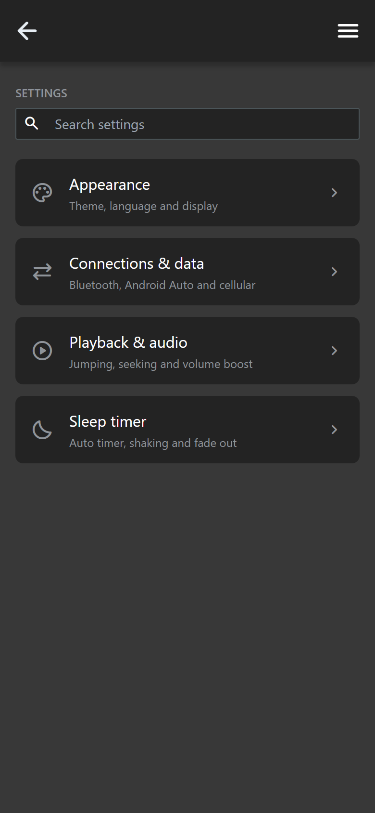
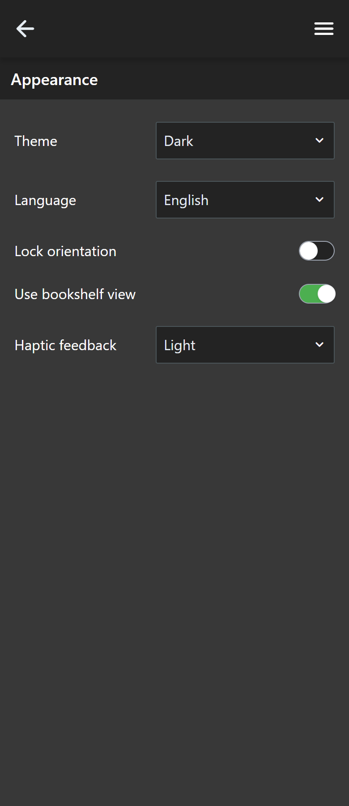
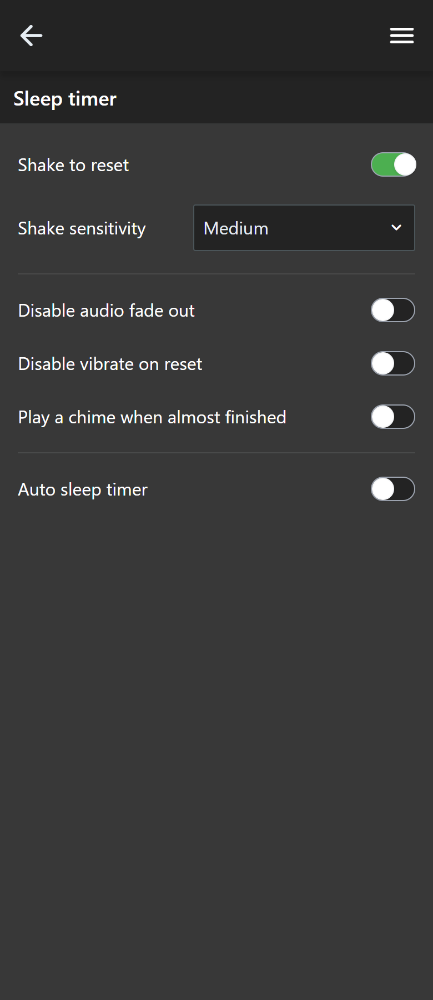
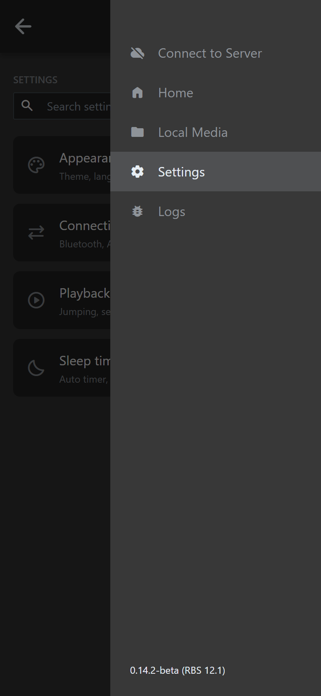

# ABS-RBS: a custom build of the Audiobookshelf Android app

**ABS-RBS** is a personal, customised Android build of the [Audiobookshelf mobile app](https://github.com/advplyr/audiobookshelf-app). It installs next to the official app (package `com.rbs.abs`, its own name and icon) and connects to your own Audiobookshelf server.

This page first lists everything that was **added or changed in this build**. Below the separator line is the **original README of the official app**, unchanged.

The build number is shown at the bottom of the side menu, behind the official version, for example `0.14.2-beta (RBS 12.1)`.

> All changes are for Android. Screenshots below come from the app's web preview with demo data.

---

## Added features

### Servers and connections

- **Custom headers on every request.** Cloudflare-style headers (for example Access client ID/secret) are sent on all requests: the API, the socket connection, downloads and covers. Headers are kept per server.
- **Internal and external address per server.** Each server has an external URL and an internal URL. The app uses the internal URL on your home Wi-Fi network (matched by the SSID, or by reachability when the SSID field is empty) and the external URL everywhere else. It switches by itself when the network changes. Only you can change the external URL; the app never edits it.
- **Connection icon.** A green Wi-Fi icon means the internal URL is in use, a cloud means the external URL. A busy icon shows while the app switches, and a red "no network" icon only appears after 2.5 seconds without a connection.
- **One server details screen.** Alias, external URL, custom headers, internal URL and Wi-Fi names are on a single full-width screen with one back button. The back gesture returns to the server list.
- **Same-server check.** After switching between the internal and external address the app still recognises downloads and items as belonging to the same server, so you no longer get the "linked to a different server" pop-up. The pop-up shows the server alias when it does appear.

<p>
  
</p>

### Bluetooth

- **Bluetooth auto play.** Start playing when your phone connects to chosen Bluetooth devices (a car or headphones). There is a master switch, a toggle for each device, a delay before playing, and an option to start even when the app is closed.
- **Auto reconnect** when the connection drops.

<p>
  
</p>

### Playback and audio

- **Volume boost.** Raise the volume up to 20 dB above the normal maximum, with a master switch. Android Auto has its own boost level, which you can step through with one button in the car.
- **Skip silence.** A switch plus a "Longest pause kept" slider (0.1 to 0.9 s). Pauses longer than the chosen length are cut down to it; shorter pauses are left alone. Off by default.
- **Playback history.** After a big jump (seeking, skipping a chapter) the app remembers where you were. A history button with a count badge opens the last 10 jumps for the book, stored on the phone. Settings: turn history on or off, ignore jumps shorter than 15 s / 30 s / 1 m / 2 m / 5 m, show a "go back" bar after a jump, and show the history count.
- **Jump times** of 1 minute are shown as `1m`.

<p>
  
  
  
</p>

*Left: the playback settings. Middle: the history button with its count and the "go back" bar after a jump. Right: the playback history list.*

### Settings

The settings are reorganised into four categories with a search box: **Appearance**, **Connections & data**, **Playback & audio** and **Sleep timer**.

<p>
  
  
  
</p>

### Android Auto

- **Chapters in the Queue** list, with a setting for what the queue shows.
- **Progress bar per chapter or for the whole book**, set separately for the notification and for Android Auto.
- **Next and previous chapter buttons.**
- **One boost button** that steps the Android Auto boost by 2 dB.
- **Cover art** served through the app, so covers also show when the server sits behind Cloudflare (which blocks the car from fetching them directly).
- **Better connection handling.** The app looks up the server address natively and retries for about three minutes. If the server cannot be reached, a "Server unreachable" tab with a retry button shows in the car instead of an empty library.

### App identity

- Own package name (`com.rbs.abs`), app name and icon, so it can be installed beside the official app.
- Build number shown in the side menu.

<p>
  
</p>

---

## Installing

APKs are built by hand and are updates of each other: same package name, same signing key, higher version code. There are no releases on Google Play. Branch `abs-rbs-fullagent` holds the latest work, and the separate feature commits are tagged (for example `aa-connection`, `aa-cover-art`, `skip-silence`, `boost-reattach`) so any one of them can be reverted on its own.

---

# Original README of the official Audiobookshelf app

The text below is the unchanged README of [advplyr/audiobookshelf-app](https://github.com/advplyr/audiobookshelf-app).

---

# Audiobookshelf Mobile App

Audiobookshelf is a self-hosted audiobook and podcast server.

### Android (beta)

Get the Android app on the [Google Play Store](https://play.google.com/store/apps/details?id=com.audiobookshelf.app)

### iOS (early beta)

**Beta is currently full. Apple has a hard limit of 10k beta testers. Updates will be posted in Discord.**

Using Test Flight: https://testflight.apple.com/join/wiic7QIW **_(beta is full)_**

---

[Go to the main project repo github.com/advplyr/audiobookshelf](https://github.com/advplyr/audiobookshelf) or the project site [audiobookshelf.org](https://audiobookshelf.org)

Join us on [discord](https://discord.gg/pJsjuNCKRq)

**Requires an Audiobookshelf server to connect with**


## Contributing

This application is built using [NuxtJS](https://nuxtjs.org/) and [Capacitor](https://capacitorjs.com/) in order to run on both iOS and Android on the same code base.

### Localization

Thank you to [Weblate](https://hosted.weblate.org/engage/audiobookshelf/) for hosting our localization infrastructure pro-bono. If you want to see Audiobookshelf in your language, please help us localize. Additional information on helping with the translations [here](https://www.audiobookshelf.org/faq#how-do-i-help-with-translations). <a href="https://hosted.weblate.org/engage/audiobookshelf/">  </a>

### Windows Environment Setup for Android

Required Software:

- [Git](https://git-scm.com/downloads)
- [Node.js](https://nodejs.org/en/) (version 20)
- Code editor of choice([VSCode](https://code.visualstudio.com/download), etc)
- [Android Studio](https://developer.android.com/studio)
- [Android SDK](https://developer.android.com/studio)

<details>
<summary>Install the required software with <a href=(https://docs.microsoft.com/en-us/windows/package-manager/winget/#production-recommended)>winget</a></summary>

<p>
Note: This requires a PowerShell prompt with winget installed.  You should be able to copy and paste the code block to install.  If you use an elevated PowerShell prompt, UAC will not pop up during the installs.

```PowerShell
winget install -e --id Git.Git; `
winget install -e --id Microsoft.VisualStudioCode; `
winget install -e --id  Google.AndroidStudio; `
winget install -e --id OpenJS.NodeJS --version 20.11.0;
```


</p>
</details>
<br>

Your Windows environment should now be set up and ready to proceed!

### Mac Environment Setup for Android

Required Software:

- [Android Studio](https://developer.android.com/studio)
- [Node.js](https://nodejs.org/en/) (version 20)
- [Cocoapods](https://guides.cocoapods.org/using/getting-started.html#installation)
- [Android SDK](https://developer.android.com/studio)

<details>
<summary>Install the required software with <a href=(https://brew.sh/)>homebrew</a></summary>

<p>

```zsh
brew install android-studio node cocoapods
```

</p>
</details>

### Start working on the Android app

Clone or fork the project from terminal or powershell and `cd` into the project directory.

Install the required node packages:

```shell
npm install
```

<details>
<summary>Expand for screenshot</summary>


</details>
<br>

Generate static web app:

```shell
npm run generate
```

<details>
<summary>Expand for screenshot</summary>


</details>
<br>

Copy web app into native android/ios folders:

```shell
npx cap sync
```

<details>
<summary>Expand for screenshot</summary>


</details>
<br>

Open Android Studio:

```shell
npx cap open android
```

<details>
<summary>Expand for screenshot</summary>


</details>
<br>

Start coding!

After making changes to the JS layer you need to rebuild the nuxt pages and sync them to the native shells:

```shell
npm run sync
```

### Mac Environment Setup for iOS

Required Software:

- [Xcode](https://developer.apple.com/xcode/)
- [Node.js](https://nodejs.org/en/)
- [Cocoapods](https://guides.cocoapods.org/using/getting-started.html#installation)

### Start working on the iOS app

Clone or fork the project in the terminal and `cd` into the project directory.

Install the required node packages:

```shell
npm install
```

<details>
<summary>Expand for screenshot</summary>


</details>
<br>

Generate static web app:

```shell
npm run generate
```

<details>
<summary>Expand for screenshot</summary>


</details>
<br>

Copy web app into native android/ios folders:

```shell
npx cap sync
```

<details>
<summary>Expand for screenshot</summary>


</details>
<br>

Open Xcode:

```shell
npx cap open ios
```

<details>
<summary>Expand for screenshot</summary>


</details>
<br>

Start coding!

After making changes to the JS layer you need to rebuild the nuxt pages and sync them to the native shells:

```shell
npm run sync
```
